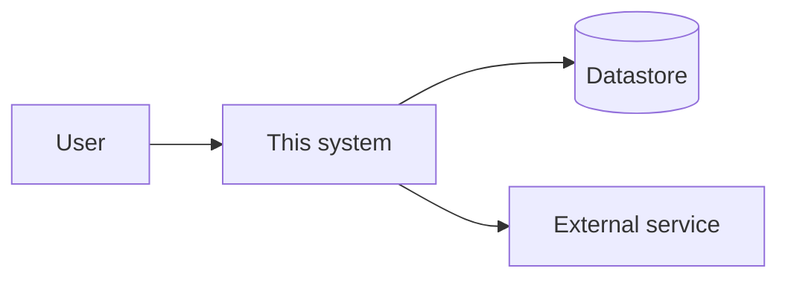

<!-- Written by /onboard (as-is) and extended by /design ([planned] parts).
     Keep `##` headings stable: tasks point at them (docs/architecture.md#auth).
     Every claim: `path/file:symbol`, an ADR link, or INFERENCE.
     Structure reference: .claude/skills/design/templates/architecture.md -->

# Architecture

- Last verified: <date> against <commit>
- Legend: [built] [planned] [changing]

## Overview
<Plain language: what the system does, for whom, how it is shaped, and
the 3-5 ideas that explain most of its design. Link the ADRs behind them.>

## System context

<One paragraph on each boundary: protocol, trust, failure behavior.>

## Components
| Component | Path | Role | Status | Why (ADR) |
|---|---|---|---|---|
| | | | | |

## <Area name, e.g. Auth>
<Repeat this block per area. Anchor = slug of the heading.>
- Purpose: <one sentence>
- How it works: <the mechanism, step by step, cited `file:symbol`>
- Interfaces: <inputs/outputs, endpoints, events, who calls it>
- Data owned: <tables/keys/files, lifecycle>
- Failure modes: <what breaks, what the caller sees, how it recovers>
- Why it is this way: <ADR-n, one line>

## Data model
<Entities, relationships, invariants, migrations policy. A table or
mermaid erDiagram.>

## Key flows
<2-3 flows that define the system, each a mermaid sequenceDiagram plus
three sentences of explanation.>

## Cross-cutting concerns
- Security (authn/z, secrets, trust boundaries):
- Errors and retries:
- Configuration and environments:
- Observability (logs, metrics, alerts):
- Performance budgets:

## Deployment and environments
<How it is built, shipped, run; environments; rollback.>

## Constraints and known debt
<What limits the design today; debt with where it lives and its impact.>

## Build and test baseline
| Check | Command | Result | Date |
|---|---|---|---|
| | | | |

## Glossary
<Project terms a new session would otherwise misread.>
